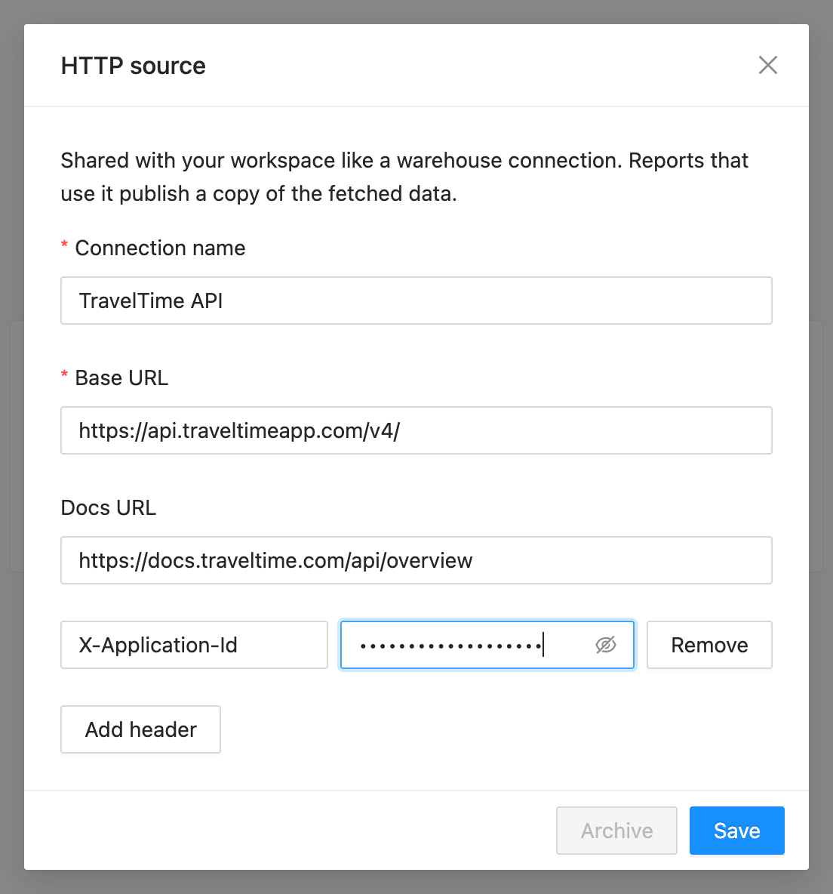
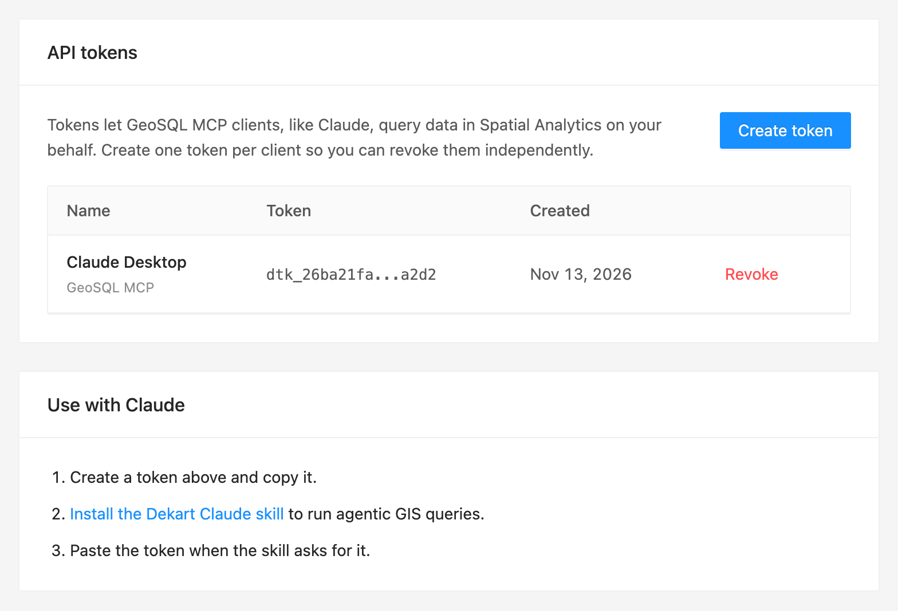
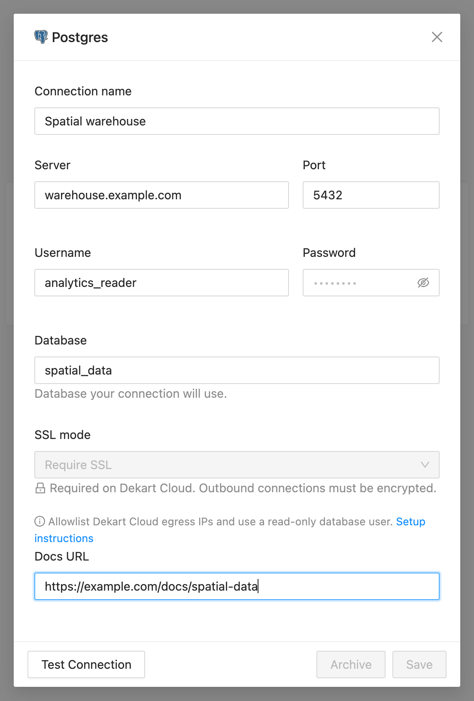
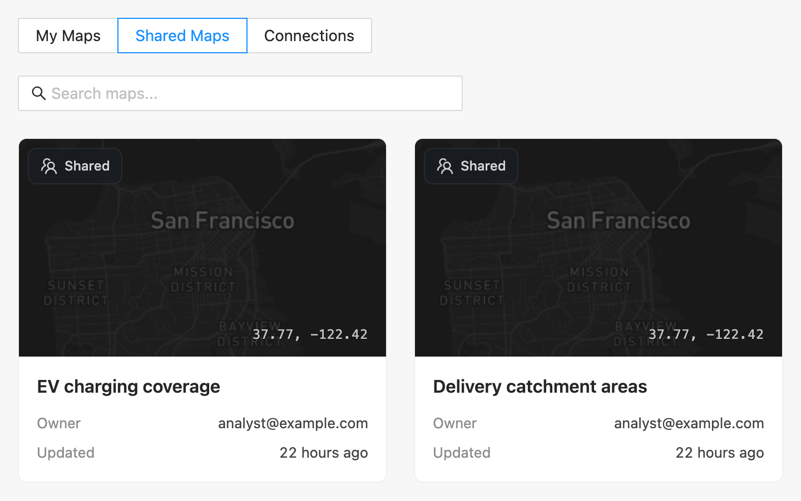
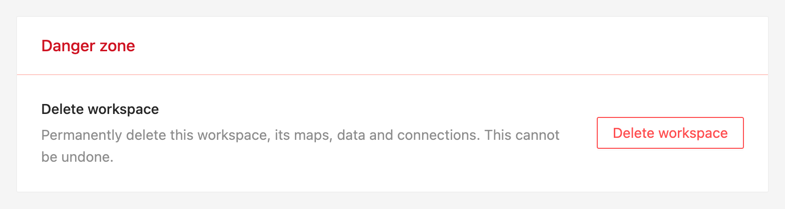

# v0.27

These notes cover changes since `v0.26`.

## 🔍 Feature Highlights

### Query HTTP data with DuckDB

Add an **HTTP connection** to read CSV, JSON, Parquet, and supported spatial files from HTTPS URLs in DuckDB SQL, then join the results with other datasets in your map. Connections can include authentication headers, which stay on the server.

Queries can also build one request URL from dataset values, for example to request a driving catchment for a selected station. Dynamic values are supported in URL query parameters; the destination host and path stay fixed. Each downloaded file is limited to 100 MB. Redirects and private network destinations are not supported.



### Create MCP tokens in workspace settings

Admins and editors can create named tokens for Claude and other MCP clients directly in workspace settings. Each token is shown once, can be copied, and can be revoked from the token list. The settings also include Claude setup instructions.



### Add documentation to any connection

Every connection type now has an optional **Docs URL**. The link is also returned by the MCP `list_connections` tool so agents can read the data documentation before writing SQL.



### Find maps shared by email

Maps shared directly with your email now appear under **Shared Maps**, including maps from another workspace. Removing access removes the map from the list. Public-link maps remain accessible by URL without being added to the list.



### Delete Cloud workspaces

Cloud admins can delete a non-default workspace from its settings after confirming its name. Paid subscriptions must first be scheduled for cancellation; deletion does not need to wait until the paid period ends. Deletion removes the workspace's maps, history, uploads, and member access.



## ⚠️ Behavior Changes

- **Replace older CLI tokens.** Device tokens without a device-session ID are now rejected. Run `dekart init` again to authorize the CLI after upgrading. Revoking a token takes effect on its next request.
- **Workspace access follows member roles.** Editors can use shared workspace connections and manage maps, but connection administration, member details, billing, and workspace administration remain admin-only. Viewers cannot create MCP tokens or use the MCP endpoints. Cloud MCP operations follow the workspace's trial and subscription restrictions.
- **HTTP sources follow report sharing.** Anyone who can open a report can download its HTTP sources through Dekart, including anonymous readers of public reports. For dataset-built URLs, readers can vary the dynamic query-parameter values within the saved template. Review upstream API permissions and usage limits before sharing.
- **Workspace deletion can retain shared credentials.** Connections and their stored credentials are retained if datasets or saved history in another workspace still reference them. The deleting admin receives a notification listing retained connections or storage objects that could not be cleaned up.

## ⚙️ Changes Important for Admins

- PostgreSQL and SQLite metadata migrations add HTTP connection settings, workspace deletion timestamps, and workspace identifiers for tracking events. They run automatically at startup.
- HTTP data is fetched by the Dekart server. Allow outbound HTTPS access to the public hosts configured in HTTP connections.
- Set the optional `DEKART_GEOSQL_MCP_URL` to show the GeoSQL MCP extension setup option for Claude Desktop in workspace settings.
- Amazon OIDC deployments now accept Dekart device bearer tokens for CLI/MCP requests and snapshot tokens for map rendering, while retaining the existing browser authentication flow.

## 🔧 User-Facing Bug Fixes

- Workspace invitations work with mixed-case email addresses, copied invitation links, and accounts whose Personal workspace trial has not started.
- Missing stored query results can be recovered by rerunning the query, restoring map layers instead of leaving them unable to display.
- Reopening a report before its first successful map save restores default layers while preserving deliberately saved empty maps.
- Unsaved query parameters, SQL, and report titles survive incoming report updates.
- Removing a report README preserves unrelated unsaved map edits and rejects stale removal requests.
- Charts remain available when navigating between maps, and rendering failures show an error instead of silently hiding the charts.
- Cloud workspace deletion handles unfinished uploads.
- CLI snapshot downloads correctly identify owned file and query results in SQLite deployments.

## 🚀 Upgrade Instructions

1. **Back up your metadata database.**

2. **Upgrade your image:**

   ```
   ghcr.io/dekart-xyz/dekart-premium/dekart:0.27
   ```

   OSS/Docker Hub deployments can use:

   ```
   dekartxyz/dekart:0.27
   ```

3. **Reauthorize existing CLI installations** with `dekart init` to replace older device tokens.

4. **Upgrade Dekart CLI before using HTTP-source queries through MCP** if your installed CLI does not support them.

The metadata migrations are applied automatically at startup.
